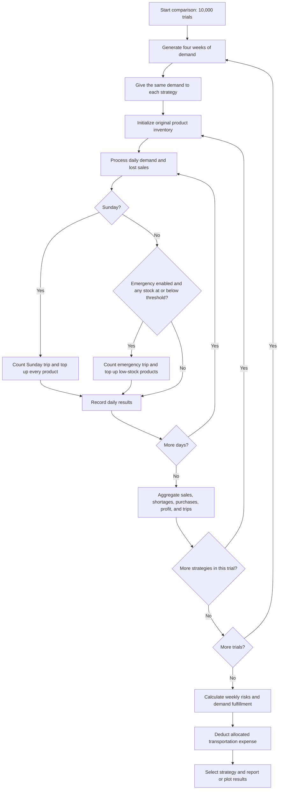

# Sari-Sari Store Monte Carlo Simulator

This Python project compares inventory replenishment policies for five sari-sari store products. It simulates customer demand over four weeks, measures shortages and sales, calculates profit after allocated transportation expenses, and selects a strategy using a weekly service target. A separate research workflow exports product and strategy statistics with approximate 95% confidence intervals to CSV.

## Implementation status

The project includes eight executable test scripts covering simulation, inventory, strategy comparison, financial calculations, chart generation, and research verification. Validation results for the current version are described under Testing.

This is a working simulation prototype. Passing tests establish the checked behavior, but do not validate the demand assumptions against actual store data. See the limitations below before treating its recommendation as a business decision.

## Setup and execution

Run commands from the **parent directory containing the `MOSI` folder**, currently `D:\Documents\MOSI`. The README and Python sources are inside its child folder, `MOSI/`:

```text
D:\Documents\MOSI\          <- run commands here
    MOSI\
        README.md
        main.py
        research_analysis.py
        requirements.txt
        ...
```

A virtual environment is recommended. Example for Windows PowerShell:

```powershell
python -m venv .venv
.\.venv\Scripts\python.exe -m pip install -r .\MOSI\requirements.txt
$env:PYTHONPATH = (Resolve-Path .\MOSI).Path
.\.venv\Scripts\python.exe -m MOSI.main
.\.venv\Scripts\python.exe -m MOSI.graphs
.\.venv\Scripts\python.exe -m MOSI.research_analysis
```

If using an existing Python environment, substitute `python` for `.\.venv\Scripts\python.exe` in these commands. The `PYTHONPATH` setting is for the current PowerShell session: `main.py` uses `MOSI.*` imports, while the other source and test files use unqualified sibling imports such as `from products import PRODUCTS`. Keeping both the parent working directory and the source folder available allows both styles to resolve. Running `python MOSI/main.py` directly can fail to resolve `MOSI`; use the module commands above.

If your terminal is already inside the source folder (`D:\Documents\MOSI\MOSI`), `python research_analysis.py`, `python graphs.py`, and `python test_research.py` work directly with an environment containing the dependencies. Their output folders are then created inside that source folder. For `main.py`, use the parent-directory setup above because its imports still require the package name.

`requirements.txt` lists NumPy, pandas, and Matplotlib. The current implementation uses Matplotlib for charts and Python's standard library for the simulation and statistics; NumPy and pandas are currently unused. Dependency versions are not pinned.

`python -m MOSI.main` runs 10,000 four-week trials for each of three strategies, prints their financial and service results, selects a strategy, and repeats financial evaluation with 0%, 50%, and 100% transportation allocation. The sensitivity calculation reuses the same simulation results.

`python -m MOSI.graphs` runs its own 10,000-trial comparison with 50% transportation allocation and saves charts in `graphs/`. Running these two scripts separately produces independent random experiments, so their figures can differ.

`python -m MOSI.research_analysis` runs a separate 10,000-trial experiment with seed 42 and 50% transportation allocation, writes two CSV files to `results/`, and prints the exported rows. It does not select a best strategy or run transportation sensitivity analysis.

## Project files

| File | Responsibility |
| --- | --- |
| `products.py` | Product names, starting inventory, demand ranges, purchase costs, and selling prices. |
| `strategies.py` | Original stock targets, fixed risk-based targets, and the emergency threshold. |
| `simulation.py` | Demand generation, single-week inventory simulation, and four-week replenishment simulation. |
| `analysis.py` | Baseline Monte Carlo statistics, confidence intervals, and comparisons using shared demand. |
| `financial.py` | Transportation allocation, profit contribution, service qualification, and strategy selection. |
| `research_analysis.py` | Seeded comparison, confidence intervals, service-support flags, and CSV exports. |
| `main.py` | Console report and transportation sensitivity analysis; executes on import. |
| `graphs.py` | Four chart outputs; `create_graphs()` also returns simulation and financial results. |
| `test_*.py` | Directly executable assertion-based checks. |
| `test_research.py` | Research checks for daily inventory accounting, shared demand, zero demand, and constant-value confidence intervals. |
| `notes` | Informal equations and policy notes. |

## Inputs and assumptions

All quantities below are units; monetary values are Philippine pesos (PHP). Demand bounds are inclusive.

| Product | Initial stock / Sunday Only target | Normal daily demand | Busy daily demand | Unit cost | Unit price | Risk-Based target |
| --- | ---: | --- | --- | ---: | ---: | ---: |
| Bottled Water | 120 | 8–12 | 15–20 | 15 | 20 | 113 |
| Soft Drinks | 144 | 8–12 | 15–20 | 18 | 25 | 113 |
| Pancit Canton | 120 | 12–20 | 12–20 | 17 | 20 | 123 |
| Magic Sarap | 100 | 10–15 | 15–25 | 6 | 8 | 135 |
| Candy | 300 | 25–50 | 40–70 | 0.50 | 1 | 381 |

Each week runs Monday through Sunday. The generator chooses four or five busy days with equal probability, then samples their positions uniformly without replacement. Each product's daily demand is an independent uniform integer draw conditional on that day's shared busy/normal classification. This shared classification can cause product demands to move together. Weeks are generated independently; no specific weekday is inherently busier.

The model assumes fixed prices, unlimited replenishment supply, and stock available the morning after purchasing. Unfulfilled demand is lost rather than backordered. It does not model spoilage, supplier delays, storage limits, or a purchasing budget.

## Strategies

| Strategy | Sunday replenishment | Emergency replenishment |
| --- | --- | --- |
| Sunday Only | Restore products to their original targets. | Disabled. |
| Risk-Based | Restore products to the fixed risk-based targets. | Disabled. |
| Risk + Emergency | Restore products to the fixed risk-based targets. | Enabled after demand on Monday through Saturday. |

For emergency purchasing, any product at or below 20% of its target triggers one trip. That trip replenishes only products currently at or below their own thresholds. Sunday uses the regular policy and never adds a separate emergency trip.

All strategies begin with `PRODUCTS[product]["initial_stock"]`, including strategies with different targets. Their target policies take effect during subsequent purchases. Targets are replenishment ceilings, not forced inventory resets: stock above a target is retained.

## Process flow



The diagram summarizes nested trial and strategy loops. A new demand scenario is generated once per trial and reused across all three strategies.

### Daily inventory logic

For each product, let `I` be inventory at the start of the day and `D` be demand:

```text
Sold units             = min(I, D)
Unfulfilled demand     = D - sold units
Stock after sales      = I - sold units
Restock quantity       = max(0, target - stock after sales)
Daily gross profit     = sold units × (selling price - unit cost)
```

Restocking occurs after customer demand, so it cannot recover that day's lost sales. A stockout day means `unfulfilled > 0`; ending with exactly zero stock while fulfilling all requests does not count as a stockout.

`simulate_week()` models seven days with initial stock and no replenishment. `simulate_four_weeks()` carries inventory across days and weeks and applies the purchasing policy. Both return `(daily_results, summary)`. Four-week summaries also include purchased units, and the final daily record holds total Sunday and emergency trip counts.

In four-week daily records, `remaining_stock` includes any end-of-day replenishment. Inventory conservation is:

```text
Initial inventory + purchased units = sold units + ending inventory
Total demand = sold units + unfulfilled demand
```

### Monte Carlo statistics

`compare_strategies(trials=10000)` uses the same generated demand for each strategy within a trial. This makes policy comparisons less affected by differing demand samples.

For each strategy and product:

```text
Weekly stockout risk = weeks with at least one unfulfilled request / (trials × 4)
Demand fulfillment  = total units sold / total units demanded
```

Fulfillment is calculated from pooled units, rather than averaging individual daily percentages. If total demand is zero, fulfillment is defined as 1.0. Average profit, purchasing cost, and trip counts are per four-week period.

`run_monte_carlo()` separately evaluates the default Sunday Only policy. It returns per-product weekly and four-week stockout probabilities, fulfillment, average unfulfilled units, ending inventory, purchased units, and gross profit. Its `monthly_stockout_probability` key refers to exactly four weeks, not a calendar month.

`confidence_interval(values)` estimates a 95% confidence interval for a mean using `mean ± 1.96 × sample_standard_deviation / sqrt(n)`. For one observation it returns that value twice. These intervals describe uncertainty in estimated means, not the range of individual outcomes. `compare_strategies()` does not report confidence intervals; the separate research workflow adds them as described below.

### Financial logic and selection

```text
Gross profit            = sum(sold units × unit margin)
Purchasing cost         = sum(purchased units × unit cost)
Allocated transport     = average trips × PHP 200 × transport_share
Profit after transport  = gross profit - allocated transport
```

Purchasing cost is reported separately. It is not subtracted again from gross profit because unit margin already deducts the cost of goods sold. Purchasing expenditure includes inventory retained for future sales, whereas gross profit concerns units actually sold. The resulting figure is a profit contribution after transport, not cash flow or full net business profit; rent, labor, utilities, taxes, and other expenses are excluded.

A product passes the service target if its estimated weekly stockout probability is at most 5%. This corresponds to at least 95% of simulated product-weeks having no shortage; it differs from a 95% unit fulfillment rate.

`choose_best_strategy()` first selects the highest profit after transport among strategies passing the target for all five products. If none qualify, it selects the strategy passing the most product targets, breaking ties by profit after transport. Service qualification therefore takes priority over maximizing profit alone.

## Chart outputs

| Output | Meaning |
| --- | --- |
| `graphs/stockout_probability.png` | Weekly stockout percentages by product, with a 5% reference line. |
| `graphs/demand_fulfillment.png` | Percentage of requested units sold by product. |
| `graphs/profit_comparison.png` | Average four-week profit contribution after allocated transportation. |
| `graphs/purchasing_trips.png` | Average Sunday plus emergency trips over four weeks. |

Charts use 300 DPI and overwrite files with the same names. Paths are relative to the current working directory. Figures are closed after saving. The graph smoke test checks file existence and size; it does not verify the plotted numerical values.

With the documented commands, `graphs/` and `results/` are created in the parent working directory, alongside the source folder. Images already in `MOSI/graphs/` are separate files.

## Research workflow and CSV outputs

`run_research_analysis(trials=10000)` seeds Python's shared random generator with 42 at the start of every call. Each trial generates four weeks of demand shared across all three strategies and records financial outcomes and product-level shortages, purchases, and ending inventory. The function returns `(product_rows, strategy_rows)` and writes:

| Output | Contents |
| --- | --- |
| `results/product_results.csv` | 15 rows: one per strategy/product pair, with weekly risk, its confidence interval, fulfillment, average unfulfilled and purchased units, ending stock, and two service flags. |
| `results/strategy_results.csv` | Three rows: average profit after transport and its confidence interval, purchase cost, trips, transport expense, and counts of products passing each service check. |

For weekly risk, each four-week trial contributes `stockout_weeks / 4`. `mean_ci()` computes the mean and approximate 95% confidence interval across these trial fractions, keeping the four weeks within each trial together. Probability interval bounds are clipped to `[0, 1]` before conversion to percentages. Profit intervals use each trial's total gross profit minus allocated transportation expense. The CSV field `Average Profit` therefore means profit **after transport**.

The product output distinguishes `Target Met` (estimated risk at most 5%) from `CI Supports Target` (the approximate interval's upper bound at most 5%). Their strategy-level counts are `Products Meeting Target` and `Targets Supported by CI`. These research flags do not change `choose_best_strategy()`, which continues to use point estimates.

CSV numeric values are rounded to two decimal places; service flags are calculated before rounding. Files with the same names are overwritten. `mean_ci()` returns `(mean, lower, upper)`; with one value all three are equal. A zero-variance sample, including all-zero observed shortages, produces a zero-width interval, so the support flag should not be interpreted as proof of the true stockout probability.

### Research configuration

| Setting in `research_analysis.py` | Default | Purpose |
| --- | --- | --- |
| `TRIALS` | `10000` | Number of independent four-week demand scenarios. Each scenario is evaluated under all three policies. |
| `SEED` | `42` | Resets Python's global random state at the start of each research run. |
| `TRANSPORT_COST` | `200` | PHP charged per purchasing trip before allocation. |
| `TRANSPORT_SHARE` | `0.50` | Fraction of the trip expense assigned to the modeled products. |
| `STRATEGIES` | Three policies | Mapping from strategy name to stock targets and emergency flag. |

For a smaller research run, use this command from the parent directory after setting `PYTHONPATH` as shown above:

```powershell
python -c "from MOSI.research_analysis import run_research_analysis; run_research_analysis(trials=100)"
```

This command still writes both CSV files and replaces any existing files at those output paths. It prints saved paths; printing all returned rows is part of the script entry point, rather than the function itself. There is no `--trials` command-line option. Passing `trials=` explicitly overrides the function's default; changing the module's `TRIALS` variable after import does not change an already-bound default argument.

### Interpreting the research tables

Weekly risk and fulfillment columns contain percentages from 0 to 100. `Avg Unfulfilled (4 weeks)` and `Avg Purchased (4 weeks)` are unit counts over 28 days; `Avg Ending Stock` is inventory after the final Sunday replenishment. Strategy profit, purchase cost, and transport columns are PHP over four weeks, and trip counts are four-week averages. Fractional averages are expected even though each individual purchase and trip count is discrete.

For example, a product with a 4.8% estimated weekly risk and an interval upper bound of 5.2% has `Target Met=True` and `CI Supports Target=False`. The point estimate passes the threshold while the reported interval crosses it. A high unit fulfillment rate can coexist with frequent stockout weeks when those shortages involve only a small number of units.

Repeated research calls with the same trial count, seed, code, and Python environment should return identical rows. Core console, chart, and research runs remain separate experiments unless explicitly given matching random states. Research execution also resets the shared random generator, so calling it inside a longer Python session affects subsequent random draws.

## Testing

The existing tests use Python assertions and do not require pytest. From the parent directory, after installing dependencies:

```powershell
$env:PYTHONPATH = (Resolve-Path .\MOSI).Path
python -m MOSI.test_simulation
python -m MOSI.test_inventory
python -m MOSI.test_four_weeks
python -m MOSI.test_analysis
python -m MOSI.test_strategies
python -m MOSI.test_financial
python -m MOSI.test_graphs
python -m MOSI.test_research
```

They cover demand bounds, busy-day counts, inventory conservation, zero and excessive demand, Sunday replenishment, statistical output bounds, financial arithmetic, strategy selection with qualifying candidates, and chart creation. The research test additionally checks daily accounting, equal demand across policies sharing a scenario, and a constant-sample interval. Some tests print extensively. `test_graphs.py` runs the full 10,000-trial comparison and overwrites chart outputs. The scripts execute checks on import as well as when launched directly.

On October 28, 2026, all eight test modules passed using the documented import-path setup after the latest import changes. Two separate 100-trial research calls each exported 15 product rows and three strategy rows, and returned identical rows, confirming repeatability for that check. These checks ran in a temporary output directory to preserve existing charts and CSV files. The research smoke check did not run the full default 10,000-trial research experiment.

## Reproducibility and customization

`main.py` and `graphs.py` do not set a random seed; `research_analysis.py` sets seed 42 on every analysis call. For a repeatable core comparison in the same Python environment, run this code from the parent directory:

```python
import random
from MOSI.analysis import compare_strategies
from MOSI.financial import analyze_finances, choose_best_strategy

random.seed(42)
simulation = compare_strategies(trials=1000)
financial = analyze_finances(simulation, transport_share=0.5)
best, meets_all_targets = choose_best_strategy(financial)
print(best, meets_all_targets)
```

Change product assumptions in `products.py`, targets and emergency percentage in `strategies.py`, and per-trip transportation cost or maximum weekly risk in `financial.py`. Research settings are separate: `TRIALS`, `SEED`, `TRANSPORT_COST`, and `TRANSPORT_SHARE` are defined in `research_analysis.py`, which also hardcodes the 5% service threshold. Update both workflows when changing shared financial assumptions. The entry points have hardcoded trial counts and allocations; edit their calls to change those settings. There is no command-line argument parser or data-file importer.

## Limitations and remaining work

- **Fixed risk-based targets:** The project compares manually supplied targets. It does not derive, optimize, or establish that these targets meet a 5% stockout constraint. The strategy's name does not guarantee qualification.
- **Initial inventory:** All policies inherit the original inventory. First-week performance can differ from later weeks under the new targets. Decide whether the intended study is a transition from current stock or a comparison starting at each policy's target.
- **Horizon and trip accounting:** The fourth Sunday restock occurs after the last simulated sales day. It adds purchases, ending stock, and a trip for future operations. Every Sunday is counted as a trip even if nothing is purchased. These are implemented conventions that should match the intended study boundary.
- **Input validation:** Trial counts must be positive integers. Zero trials in the core analysis and an empty `confidence_interval()` input raise `ZeroDivisionError`; empty research samples passed to `mean_ci()` raise `statistics.StatisticsError`. Custom demand, target mappings, transport allocation, and supplied weeks are not validated. Malformed data may fail or produce invalid results.
- **Fixed product count:** Service qualification and console messages assume five products. Adding or removing products requires updating that logic as well as configuration.
- **Statistical qualification:** Core strategy selection uses point estimates at the 5% boundary. Research exports add an approximate interval-based support flag, but selection does not use it. All reported intervals use a normal approximation, which is less reliable for small or zero-variance samples. Observing zero shortages does not prove the true probability is zero. The project does not report paired confidence intervals for profit differences between policies.
- **Import consistency:** `main.py` uses package imports, while other modules use unqualified sibling imports. The documented session setup supports both; consistent imports would simplify execution and avoid loading the same source under different module names.
- **Model validation:** Demand distributions and busy-day frequency have not been calibrated here against historical sales or unmet-demand records. Financial outputs exclude several operating expenses and inventory financing effects.
- **Coverage gaps:** Existing tests do not directly establish exact emergency threshold behavior, fallback selection when no strategy qualifies, invalid-input handling, or numerical chart accuracy. The review added an ad hoc emergency timing check, but no persistent test changes.

The implementation supports its current default experiment. General-purpose input handling, calibrated assumptions, stronger statistical qualification, and an explicit decision on horizon accounting remain necessary for a more robust decision tool.
