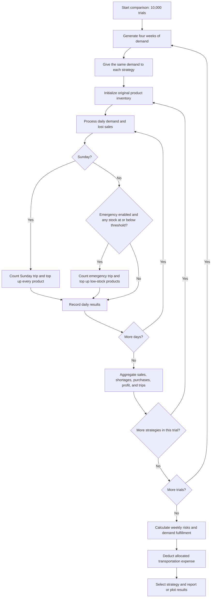

# Sari-Sari Store Monte Carlo Simulator

This Python project compares inventory replenishment policies for five sari-sari store products. It simulates customer demand over four weeks, measures shortages and sales, calculates profit after allocated transportation expenses, and selects a strategy using a weekly service target.

## Implementation status

The default end-to-end workflow is implemented and runs successfully. During review on October 28, 2026, all seven existing `test_*.py` scripts and `main.py` passed on Python 3.12.6. The graph test generated all four nonempty PNG files. Additional deterministic checks confirmed emergency replenishment timing and selective purchasing.

This is a working simulation prototype. Passing tests establish the checked behavior, but do not validate the demand assumptions against actual store data. See the limitations below before treating its recommendation as a business decision.

## Setup and execution

Run commands from the project directory. A virtual environment is recommended. Example for Windows PowerShell:

```powershell
python -m venv .venv
.\.venv\Scripts\python.exe -m pip install -r requirements.txt
.\.venv\Scripts\python.exe main.py
.\.venv\Scripts\python.exe graphs.py
```

If using an existing Python environment, run `python -m pip install -r requirements.txt`, then `python main.py` or `python graphs.py`.

`requirements.txt` lists NumPy, pandas, and Matplotlib. The current implementation uses Matplotlib for charts and Python's standard library for the simulation and statistics; NumPy and pandas are currently unused. Dependency versions are not pinned.

`main.py` runs 10,000 four-week trials for each of three strategies, prints their financial and service results, selects a strategy, and repeats financial evaluation with 0%, 50%, and 100% transportation allocation. The sensitivity calculation reuses the same simulation results.

`graphs.py` runs its own 10,000-trial comparison with 50% transportation allocation and saves charts in `graphs/`. Running these two scripts separately produces independent random experiments, so their figures can differ.

## Project files

| File | Responsibility |
| --- | --- |
| `products.py` | Product names, starting inventory, demand ranges, purchase costs, and selling prices. |
| `strategies.py` | Original stock targets, fixed risk-based targets, and the emergency threshold. |
| `simulation.py` | Demand generation, single-week inventory simulation, and four-week replenishment simulation. |
| `analysis.py` | Baseline Monte Carlo statistics, confidence intervals, and comparisons using shared demand. |
| `financial.py` | Transportation allocation, profit contribution, service qualification, and strategy selection. |
| `main.py` | Console report and transportation sensitivity analysis; executes on import. |
| `graphs.py` | Four chart outputs; `create_graphs()` also returns simulation and financial results. |
| `test_*.py` | Directly executable assertion-based checks. |
| `notes` | Informal equations and policy notes. |

## Inputs and assumptions

All quantities below are units; monetary values are Philippine pesos (PHP). Demand bounds are inclusive.

| Product | Initial stock / Sunday Only target | Normal daily demand | Busy daily demand | Unit cost | Unit price | Risk-Based target |
| --- | ---: | --- | --- | ---: | ---: | ---: |
| Bottled Water | 120 | 8–12 | 15–20 | 15 | 20 | 113 |
| Soft Drinks | 144 | 8–12 | 15–20 | 18 | 25 | 113 |
| Pancit Canton | 120 | 12–20 | 12–20 | 17 | 20 | 123 |
| Magic Sarap | 100 | 10–15 | 15–25 | 6 | 8 | 135 |
| Candy | 300 | 25–50 | 40–70 | 0.50 | 1 | 381 |

Each week runs Monday through Sunday. The generator chooses four or five busy days with equal probability, then samples their positions uniformly without replacement. Each product's daily demand is an independent uniform integer draw conditional on that day's shared busy/normal classification. This shared classification can cause product demands to move together. Weeks are generated independently; no specific weekday is inherently busier.

The model assumes fixed prices, unlimited replenishment supply, and stock available the morning after purchasing. Unfulfilled demand is lost rather than backordered. It does not model spoilage, supplier delays, storage limits, or a purchasing budget.

## Strategies

| Strategy | Sunday replenishment | Emergency replenishment |
| --- | --- | --- |
| Sunday Only | Restore products to their original targets. | Disabled. |
| Risk-Based | Restore products to the fixed risk-based targets. | Disabled. |
| Risk + Emergency | Restore products to the fixed risk-based targets. | Enabled after demand on Monday through Saturday. |

For emergency purchasing, any product at or below 20% of its target triggers one trip. That trip replenishes only products currently at or below their own thresholds. Sunday uses the regular policy and never adds a separate emergency trip.

All strategies begin with `PRODUCTS[product]["initial_stock"]`, including strategies with different targets. Their target policies take effect during subsequent purchases. Targets are replenishment ceilings, not forced inventory resets: stock above a target is retained.

## Process flow



The diagram summarizes nested trial and strategy loops. A new demand scenario is generated once per trial and reused across all three strategies.

### Daily inventory logic

For each product, let `I` be inventory at the start of the day and `D` be demand:

```text
Sold units             = min(I, D)
Unfulfilled demand     = D - sold units
Stock after sales      = I - sold units
Restock quantity       = max(0, target - stock after sales)
Daily gross profit     = sold units × (selling price - unit cost)
```

Restocking occurs after customer demand, so it cannot recover that day's lost sales. A stockout day means `unfulfilled > 0`; ending with exactly zero stock while fulfilling all requests does not count as a stockout.

`simulate_week()` models seven days with initial stock and no replenishment. `simulate_four_weeks()` carries inventory across days and weeks and applies the purchasing policy. Both return `(daily_results, summary)`. Four-week summaries also include purchased units, and the final daily record holds total Sunday and emergency trip counts.

In four-week daily records, `remaining_stock` includes any end-of-day replenishment. Inventory conservation is:

```text
Initial inventory + purchased units = sold units + ending inventory
Total demand = sold units + unfulfilled demand
```

### Monte Carlo statistics

`compare_strategies(trials=10000)` uses the same generated demand for each strategy within a trial. This makes policy comparisons less affected by differing demand samples.

For each strategy and product:

```text
Weekly stockout risk = weeks with at least one unfulfilled request / (trials × 4)
Demand fulfillment  = total units sold / total units demanded
```

Fulfillment is calculated from pooled units, rather than averaging individual daily percentages. If total demand is zero, fulfillment is defined as 1.0. Average profit, purchasing cost, and trip counts are per four-week period.

`run_monte_carlo()` separately evaluates the default Sunday Only policy. It returns per-product weekly and four-week stockout probabilities, fulfillment, average unfulfilled units, ending inventory, purchased units, and gross profit. Its `monthly_stockout_probability` key refers to exactly four weeks, not a calendar month.

`confidence_interval(values)` estimates a 95% confidence interval for a mean using `mean ± 1.96 × sample_standard_deviation / sqrt(n)`. For one observation it returns that value twice. These intervals describe uncertainty in estimated means, not the range of individual outcomes. Strategy comparison does not currently report confidence intervals.

### Financial logic and selection

```text
Gross profit            = sum(sold units × unit margin)
Purchasing cost         = sum(purchased units × unit cost)
Allocated transport     = average trips × PHP 200 × transport_share
Profit after transport  = gross profit - allocated transport
```

Purchasing cost is reported separately. It is not subtracted again from gross profit because unit margin already deducts the cost of goods sold. Purchasing expenditure includes inventory retained for future sales, whereas gross profit concerns units actually sold. The resulting figure is a profit contribution after transport, not cash flow or full net business profit; rent, labor, utilities, taxes, and other expenses are excluded.

A product passes the service target if its estimated weekly stockout probability is at most 5%. This corresponds to at least 95% of simulated product-weeks having no shortage; it differs from a 95% unit fulfillment rate.

`choose_best_strategy()` first selects the highest profit after transport among strategies passing the target for all five products. If none qualify, it selects the strategy passing the most product targets, breaking ties by profit after transport. Service qualification therefore takes priority over maximizing profit alone.

## Chart outputs

| Output | Meaning |
| --- | --- |
| `graphs/stockout_probability.png` | Weekly stockout percentages by product, with a 5% reference line. |
| `graphs/demand_fulfillment.png` | Percentage of requested units sold by product. |
| `graphs/profit_comparison.png` | Average four-week profit contribution after allocated transportation. |
| `graphs/purchasing_trips.png` | Average Sunday plus emergency trips over four weeks. |

Charts use 300 DPI and overwrite files with the same names. Paths are relative to the current working directory. Figures are closed after saving. The graph smoke test checks file existence and size; it does not verify the plotted numerical values.

## Testing

The existing tests run directly with Python and do not require pytest:

```powershell
python test_simulation.py
python test_inventory.py
python test_four_weeks.py
python test_analysis.py
python test_strategies.py
python test_financial.py
python test_graphs.py
```

They cover demand bounds, busy-day counts, inventory conservation, zero and excessive demand, Sunday replenishment, statistical output bounds, financial arithmetic, strategy selection with qualifying candidates, and chart creation. Some tests print extensively. `test_graphs.py` runs the full 10,000-trial comparison and overwrites chart outputs. The scripts execute checks on import as well as when launched directly.

## Reproducibility and customization

The scripts do not set a random seed. For a repeatable comparison in the same Python environment:

```python
import random
from analysis import compare_strategies
from financial import analyze_finances, choose_best_strategy

random.seed(42)
simulation = compare_strategies(trials=1000)
financial = analyze_finances(simulation, transport_share=0.5)
best, meets_all_targets = choose_best_strategy(financial)
print(best, meets_all_targets)
```

Change product assumptions in `products.py`, targets and emergency percentage in `strategies.py`, and per-trip transportation cost or maximum weekly risk in `financial.py`. The command-line entry points have hardcoded trial counts and allocations; edit their calls to change those settings. There is no command-line argument parser or data-file importer.

## Limitations and remaining work

- **Fixed risk-based targets:** The project compares manually supplied targets. It does not derive, optimize, or establish that these targets meet a 5% stockout constraint. The strategy's name does not guarantee qualification.
- **Initial inventory:** All policies inherit the original inventory. First-week performance can differ from later weeks under the new targets. Decide whether the intended study is a transition from current stock or a comparison starting at each policy's target.
- **Horizon and trip accounting:** The fourth Sunday restock occurs after the last simulated sales day. It adds purchases, ending stock, and a trip for future operations. Every Sunday is counted as a trip even if nothing is purchased. These are implemented conventions that should match the intended study boundary.
- **Input validation:** Trial counts must be positive integers; zero trials currently raise `ZeroDivisionError`. `confidence_interval([])` also raises `ZeroDivisionError`. Custom demand, target mappings, transport allocation, and supplied weeks are not validated. Malformed data may fail or produce invalid results.
- **Fixed product count:** Service qualification and console messages assume five products. Adding or removing products requires updating that logic as well as configuration.
- **Statistical qualification:** Strategy selection uses point estimates at the 5% boundary, without uncertainty intervals or a statistical qualification rule. Observing zero shortages does not prove the true probability is zero. Baseline mean intervals use a normal approximation, which is less reliable for small samples.
- **Model validation:** Demand distributions and busy-day frequency have not been calibrated here against historical sales or unmet-demand records. Financial outputs exclude several operating expenses and inventory financing effects.
- **Coverage gaps:** Existing tests do not directly establish exact emergency threshold behavior, fallback selection when no strategy qualifies, invalid-input handling, or numerical chart accuracy. The review added an ad hoc emergency timing check, but no persistent test changes.

The implementation supports its current default experiment. General-purpose input handling, calibrated assumptions, stronger statistical qualification, and an explicit decision on horizon accounting remain necessary for a more robust decision tool.
